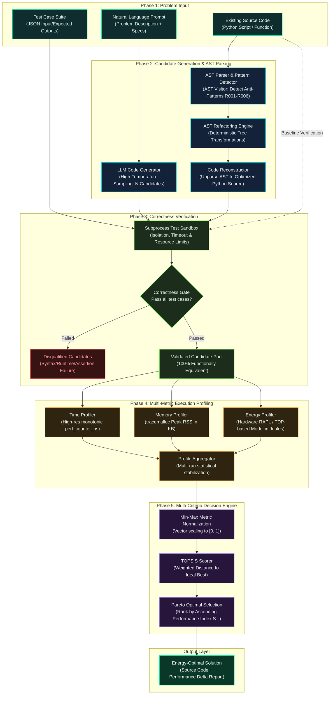
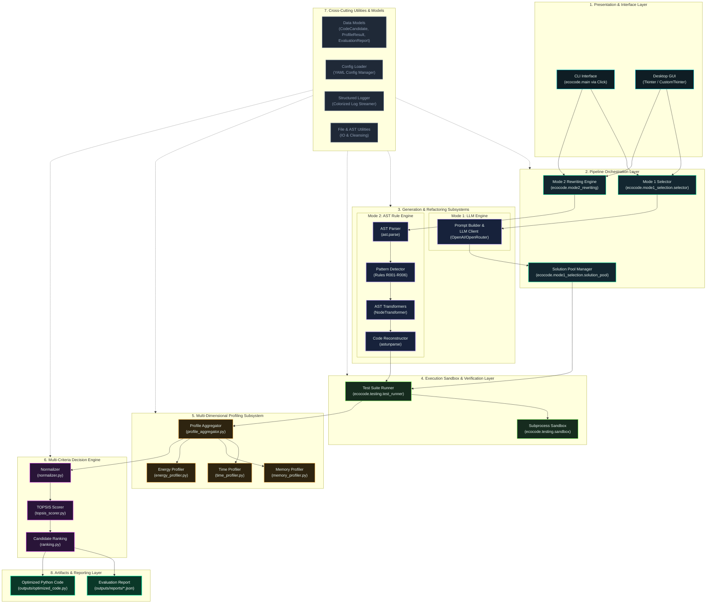
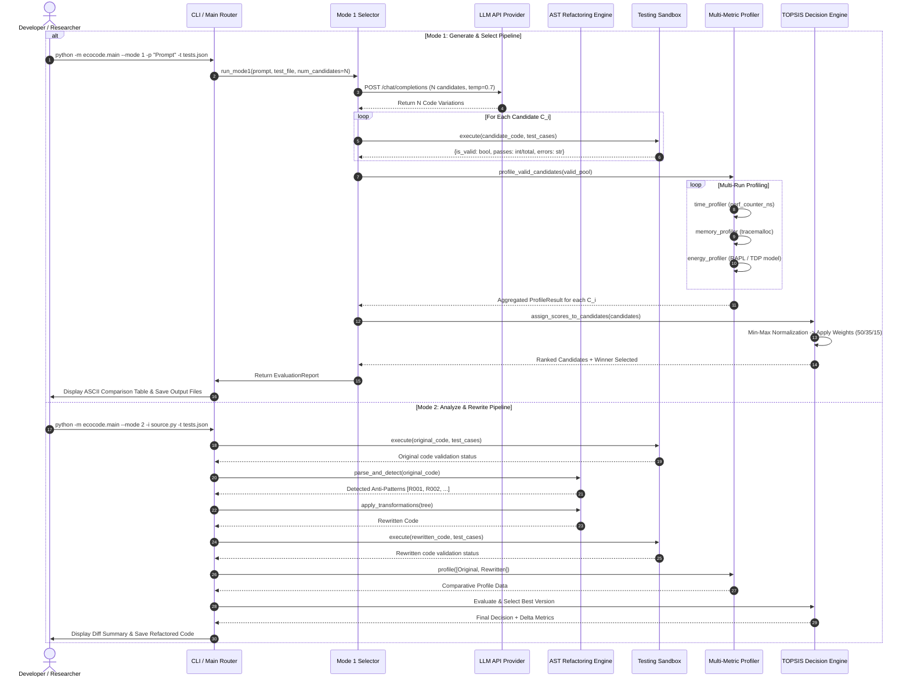

# 🌿 EcoCode-LLM: Architecture & Methodology Diagrams

Comprehensive technical specification and standard architectural diagrams for **EcoCode-LLM** — an automated Green AI optimization framework for energy-efficient code generation and refactoring.

---

## Table of Contents
1. [Diagram 1: Proposed Framework & Methodology](#1-proposed-framework--methodology)
2. [Diagram 2: System Architecture](#2-system-architecture)
3. [Diagram 3: End-to-End Execution Flowchart](#3-end-to-end-execution-flowchart)
4. [Diagram 4: Component Interaction Sequence Flow](#4-component-interaction-sequence-flow)
5. [Diagram 5: TOPSIS Decision Engine Formulation](#5-topsis-decision-engine-formulation)
6. [Supported AST Energy Optimization Rules (Mode 2)](#6-supported-ast-energy-optimization-rules-mode-2)

---

## 1. Proposed Framework & Methodology

### 1.1 Methodology Pipeline Diagram

### 1.2 Methodological Phases Overview

| Phase | Component | Input | Primary Operation | Output |
| :--- | :--- | :--- | :--- | :--- |
| **Phase 1** | Problem Specification | Prompt / Source File, Tests | Load YAML configurations, parse CLI arguments, and ingest test cases. | Structured Problem Definition |
| **Phase 2** | Code Generation / AST Parse | Prompt / Python Code | **Mode 1**: Stochastic LLM sampling ($N$ variants). **Mode 2**: AST node traversal & pattern detection. | Raw Source Code Pool / Refactored AST |
| **Phase 3** | Correctness Verification | Code Variants, Test Suite | Execution in dedicated subprocess sandbox with timeout traps. | Valid Functional Solutions Pool |
| **Phase 4** | Multi-Metric Profiling | Valid Candidates | Isolate execution across $k$ warmups + $m$ timed runs: Time (ms), RAM (KB), Energy (J). | Raw Multi-Metric Matrix $\mathbf{X}$ |
| **Phase 5** | Decision & Selection | Profile Matrix $\mathbf{X}$ | Min-Max normalization followed by weighted TOPSIS distance calculation. | Optimal Solution & Delta Metrics |

---

## 2. System Architecture

### 2.1 Layered Modular Architecture Diagram

---

## 3. End-to-End Execution Flowchart

### 3.1 Detailed Algorithmic Control Flow

```mermaid
flowchart TD
    START(["Start Execution"]) --> INIT["Load configuration (config.yaml)\nInitialize logger & parse CLI/GUI inputs"]
    INIT --> CHECK_MODE{"Evaluation Mode?"}

    %% ---------------- MODE 1 BRANCH ----------------
    CHECK_MODE -- "Mode 1 (Generation)" --> M1_PROMPT{"Prompt & Test File\nprovided?"}
    M1_PROMPT -- No --> ERR_M1_PARAM["Raise Parameter Error"] --> TERMINATE(["Aborted"])
    M1_PROMPT -- Yes --> M1_LLM["Send System Prompt to LLM API\nSample N candidates at temperature T=0.7"]
    M1_LLM --> M1_API_OK{"API Call\nSuccessful?"}
    M1_API_OK -- No --> ERR_API["Log API Failure"] --> TERMINATE
    M1_API_OK -- Yes --> M1_CLEAN["Strip Markdown wrappers\nExtract executable Python functions"]
    M1_CLEAN --> M1_LOAD_TESTS["Load Test Suite from JSON"]
    M1_LOAD_TESTS --> M1_TEST_LOOP[/"Iterate each Candidate C_i"/]

    M1_TEST_LOOP --> M1_SANDBOX["Execute in Isolated Subprocess\nInject input args -> Validate return value"]
    M1_SANDBOX --> M1_PASS{"Passed 100%\nTest Cases?"}
    M1_PASS -- No --> M1_FAIL_LOG["Mark is_valid = False\nRecord traceback"]
    M1_PASS -- Yes --> M1_PASS_LOG["Mark is_valid = True\nAdd to Valid Pool"]

    M1_FAIL_LOG --> M1_NEXT{"More\ncandidates?"}
    M1_PASS_LOG --> M1_NEXT
    M1_NEXT -- Yes --> M1_TEST_LOOP
    M1_NEXT -- No --> M1_CHECK_SURVIVORS{"Valid Pool\nSize > 0?"}

    M1_CHECK_SURVIVORS -- No --> ERR_NO_VALID["Error: No candidates passed test suite"] --> TERMINATE
    M1_CHECK_SURVIVORS -- Yes --> PROFILE_STAGE

    %% ---------------- MODE 2 BRANCH ----------------
    CHECK_MODE -- "Mode 2 (Refactoring)" --> M2_INPUT{"Source File & Test File\nprovided?"}
    M2_INPUT -- No --> ERR_M2_PARAM["Raise Parameter Error"] --> TERMINATE
    M2_INPUT -- Yes --> M2_READ["Read Source Code File"]
    M2_READ --> M2_VERIFY_ORIG["Run Original Code against Test Suite"]
    M2_VERIFY_ORIG --> M2_ORIG_PASS{"Original Code\nPasses Tests?"}
    M2_ORIG_PASS -- No --> ERR_ORIG_FAIL["Error: Baseline code fails test suite.\nCannot refactor unsafe code."] --> TERMINATE

    M2_ORIG_PASS -- Yes --> M2_PARSE["Parse Source to AST (ast.parse)"]
    M2_PARSE --> M2_PARSE_OK{"Valid Python\nAST?"}
    M2_PARSE_OK -- No --> ERR_AST["Error: Syntax parse failure"] --> TERMINATE

    M2_PARSE_OK -- Yes --> M2_DETECT["Traverse AST with Rule Detectors\n(R001: Quadratic loops, R002: Str concat,\nR003: Redundant calls, R004: Inefficient lookups)"]
    M2_DETECT --> M2_HAS_PATTERNS{"Anti-Patterns\nFound?"}

    M2_HAS_PATTERNS -- No --> M2_NO_OP["Log: Code is already optimal\nProfile original code only"] --> M2_SOLO_PROFILE["Profile Original"] --> WRITE_OUTPUT
    M2_HAS_PATTERNS -- Yes --> M2_APPLY_RULES["Apply AST Node Transformers\n(refactoring_rules.py)"]
    M2_APPLY_RULES --> M2_RECON["Reconstruct Source Code (astunparse)"]
    M2_RECON --> M2_VALIDATE_RW["Execute Rewritten Code in Sandbox"]
    M2_VALIDATE_RW --> M2_RW_PASS{"Rewritten Code\nPasses Tests?"}

    M2_RW_PASS -- No --> M2_ROLLBACK["Warning: Semantic regression detected!\nRollback to original code safely."] --> M2_SOLO_PROFILE
    M2_RW_PASS -- Yes --> M2_PAIR_POOL["Construct Comparison Pool:\n[Original, Rewritten]"] --> PROFILE_STAGE

    %% ---------------- PROFILING & TOPSIS ----------------
    PROFILE_STAGE["Multi-Metric Profiling Engine"] --> P_WARMUP["Execute W Warmup Runs (Discarded)"]
    P_WARMUP --> P_EXEC["Execute M Measurement Runs"]
    P_EXEC --> P_TIME["Record Execution Time\n(time.perf_counter_ns)"]
    P_EXEC --> P_MEM["Record Peak Memory\n(tracemalloc.get_traced_memory)"]
    P_EXEC --> P_ENG["Record Energy Footprint\n(RAPL / TDP * Delta_t)"]

    P_TIME & P_MEM & P_ENG --> P_AGG["Compute Median / Mean Values"]
    P_AGG --> TOPS_NORM["Min-Max Normalization of Metrics:\nE_norm, T_norm, M_norm in [0, 1]"]
    TOPS_NORM --> TOPS_SCORE["Compute Performance Score:\nS_i = 0.50*E_norm + 0.35*T_norm + 0.15*M_norm"]
    TOPS_SCORE --> TOPS_RANK["Sort Candidates by Ascending Score S_i"]
    TOPS_RANK --> SELECT_WINNER["Select Rank #1 as Optimal Solution\nCompute % Improvement vs Baseline/Mean"]

    SELECT_WINNER --> WRITE_OUTPUT["Generate Evaluation Report (JSON)\nSave Optimized Code (.py)\nRender Terminal Comparison Table"]
    WRITE_OUTPUT --> SUCCESS_END(["Optimal Solution Delivered"])

    %% Styling
    classDef startEnd fill:#0f2e22,stroke:#00e5a0,stroke-width:2px,color:#00e5a0;
    classDef decision fill:#112030,stroke:#00c9d4,stroke-width:1.5px,color:#e8f5f0;
    classDef process fill:#141f2d,stroke:#00c9d4,stroke-width:1.5px,color:#e8f5f0;
    classDef errNode fill:#2d1313,stroke:#ff6b6b,stroke-width:1.5px,color:#ff8888;
    classDef profNode fill:#2a2010,stroke:#ffb84d,stroke-width:1.5px,color:#ffe099;
    classDef decNode fill:#261338,stroke:#a78bfa,stroke-width:1.5px,color:#dfccf7;

    class START,SUCCESS_END startEnd;
    class CHECK_MODE,M1_PROMPT,M1_API_OK,M1_PASS,M1_NEXT,M1_CHECK_SURVIVORS,M2_INPUT,M2_ORIG_PASS,M2_PARSE_OK,M2_HAS_PATTERNS,M2_RW_PASS decision;
    class INIT,M1_LLM,M1_CLEAN,M1_LOAD_TESTS,M1_SANDBOX,M1_PASS_LOG,M2_READ,M2_VERIFY_ORIG,M2_PARSE,M2_DETECT,M2_APPLY_RULES,M2_RECON,M2_VALIDATE_RW,M2_PAIR_POOL process;
    class ERR_M1_PARAM,ERR_API,ERR_NO_VALID,ERR_M2_PARAM,ERR_ORIG_FAIL,ERR_AST,TERMINATE errNode;
    class M1_FAIL_LOG,M2_ROLLBACK,M2_NO_OP errNode;
    class PROFILE_STAGE,P_WARMUP,P_EXEC,P_TIME,P_MEM,P_ENG,P_AGG,M2_SOLO_PROFILE profNode;
    class TOPS_NORM,TOPS_SCORE,TOPS_RANK,SELECT_WINNER,WRITE_OUTPUT decNode;
```

---

## 4. Component Interaction Sequence Flow

---

## 5. TOPSIS Decision Engine Formulation

### 5.1 Multi-Criteria Optimization Model

The EcoCode-LLM Decision Engine models candidate evaluation as a multi-criteria optimization problem where lower metric values correspond to superior candidates (cost criteria).

$$\min \quad f(C_i) = \Big( E(C_i), \; T(C_i), \; M(C_i) \Big)$$

Where:
- $E(C_i)$: Measured Energy Consumption in Joules ($\text{J}$)
- $T(C_i)$: Monotonic Execution Time in Milliseconds ($\text{ms}$)
- $M(C_i)$: Peak Resident Memory in Kilobytes ($\text{KB}$)

```mermaid
flowchart LR
    subgraph INPUT_DATA [" Raw Metric Matrix (m candidates x 3 metrics) "]
        M_RAW["Energy E_i (J)\nTime T_i (ms)\nMemory M_i (KB)"]
    end

    subgraph STEP1 [" 1. Min-Max Normalization "]
        NORM_EQ["norm_x = (x_i - min_x) / (max_x - min_x + eps)\nMaps all metrics to range [0.0, 1.0]"]
    end

    subgraph STEP2 [" 2. Weight Assignment Matrix "]
        W_E["w_Energy = 0.50 (Highest Priority)"]
        W_T["w_Time = 0.35 (Performance)"]
        W_M["w_Memory = 0.15 (Footprint)"]
    end

    subgraph STEP3 [" 3. Composite Score Formulation "]
        SCORE_EQ["S_i = (w_E * E_norm) + (w_T * T_norm) + (w_M * M_norm)\nLower Score = Closer to Ideal Solution (0, 0, 0)"]
    end

    subgraph STEP4 [" 4. Ranking & Selection "]
        WINNER["Rank #1: Minimum S_i\nCompute Energy & Speedup Gain vs Baseline"]
    end

    INPUT_DATA --> STEP1
    STEP1 --> STEP2
    STEP2 --> STEP3
    STEP3 --> STEP4

    style INPUT_DATA fill:#111827,stroke:#00c9d4,stroke-width:1.5px,color:#e8f5f0;
    style STEP1 fill:#172554,stroke:#3b82f6,stroke-width:1.5px,color:#e8f5f0;
    style STEP2 fill:#1e1b4b,stroke:#8b5cf6,stroke-width:1.5px,color:#e8f5f0;
    style STEP3 fill:#311042,stroke:#d946ef,stroke-width:1.5px,color:#e8f5f0;
    style STEP4 fill:#064e3b,stroke:#00e5a0,stroke-width:2px,color:#ffffff;
```

---

## 6. Supported AST Energy Optimization Rules (Mode 2)

| Rule ID | Anti-Pattern Name | Inefficient AST Structure | Optimized Transformation | Energy Impact |
| :--- | :--- | :--- | :--- | :--- |
| **R001** | Quadratic Nested Membership | `for x in A: if x in list_B` ($O(n \cdot m)$) | Convert target collection to `set(list_B)` prior to loop ($O(n + m)$) | **High** (Up to 90% reduction) |
| **R002** | In-Loop String Accumulation | `s = ""; for x in A: s += x` | Replace with `"".join([...])` list comprehension | **Medium-High** (Reduces memory re-allocations) |
| **R003** | Invariant Function Re-computation | `for x in A: if x > len(B): ...` | Hoist invariant expression `_len = len(B)` outside loop | **Medium** (Eliminates repeated bytecode calls) |
| **R004** | Redundant Lookup Operations | `for k in dict.keys(): v = dict[k]` | Refactor to `for k, v in dict.items():` | **Low-Medium** (Avoids hashing overhead) |
| **R005** | Naive List Deduplication | `res = []; for x in A: if x not in res: res.append(x)` | Replace with `list(dict.fromkeys(A))` or `set()` | **High** (Eliminates quadratic linear scan) |
| **R006** | Uncached Recursion | Exponential recursive function calls | Decorate with `@functools.lru_cache(maxsize=None)` | **Critical** ($O(2^n) \to O(n)$ complexity reduction) |

---

*Generated for the EcoCode-LLM Research Project &middot; UIU Green Computing.*
