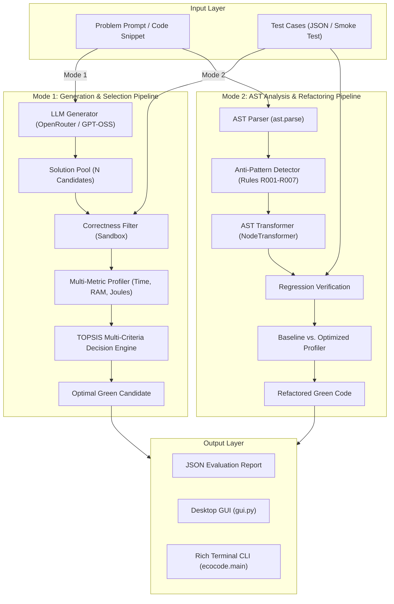

# Technical Project Report: EcoCode-LLM
## A Green AI Framework for Energy-Efficient Code Generation & AST Optimization

---

### Executive Summary

AI-assisted code generation models (e.g., ChatGPT, Claude, DeepSeek, GitHub Copilot) have revolutionized software engineering productivity. However, existing code generation models prioritize syntactic correctness and token likelihood over **energy efficiency**, computational complexity, and resource utilization. As a consequence, AI-generated code frequently contains redundant operations, high time complexity ($O(N^2)$ vs $O(N)$), excessive memory allocations, and inefficient patterns that inflate carbon footprints and datacenter electricity consumption.

**EcoCode-LLM** is an end-to-end Green AI middleware framework designed to solve this problem across two operational paradigms:
1. **Mode 1 (Multi-Candidate Generation & TOPSIS Selection)**: Generates $N$ candidate implementations via LLMs, validates correctness through sandboxed test suites, measures execution time, peak memory, and Joules, and ranks solutions using the **TOPSIS (Technique for Order of Preference by Similarity to Ideal Solution)** multi-criteria decision engine.
2. **Mode 2 (Static AST Analysis & Energy Refactoring)**: Traverses Python Abstract Syntax Trees (AST) to detect known energy-wasteful anti-patterns and rewrites them into mathematically and computationally efficient equivalents without altering functional semantics.

---

### 1. High-Level System Architecture



---

### 2. Mathematical & Algorithmic Foundations

#### 2.1 TOPSIS Decision Engine Formulation

The framework employs **TOPSIS** to resolve trade-offs between execution speed, memory footprint, and energy consumption.

1. **Normalization**:
   For each candidate $i$ across metric $j \in \{\text{Energy}, \text{Time}, \text{Memory}\}$:
   $$x'_{ij} = \frac{x_{ij} - \min_k(x_{kj})}{\max_k(x_{kj}) - \min_k(x_{kj}) + \epsilon}$$
   If all candidates yield identical metric values, $x'_{ij} = 0.0$.

2. **Weighted Score Aggregation**:
   The composite green penalty score $S_i$ is computed as:
   $$S_i = w_E \cdot x'_{i,\text{Energy}} + w_T \cdot x'_{i,\text{Time}} + w_M \cdot x'_{i,\text{Memory}}$$
   Where default weights are:
   - $w_E = 0.50$ (Energy Consumption - Primary Objective)
   - $w_T = 0.35$ (Execution Time)
   - $w_M = 0.15$ (Peak Memory Usage)
   - Condition: $w_E + w_T + w_M = 1.0$

3. **Winner Selection**:
   The candidate minimizing the TOPSIS penalty is selected:
   $$i^* = \arg\min_i (S_i)$$

#### 2.2 Energy Estimation Model

When hardware power meters (e.g., RAPL/NVML) are unavailable or running across cross-platform environments, energy consumption $E$ (Joules) is calculated via the physical power model:
$$E = P_{\text{avg}} \cdot t = \left( P_{\text{CPU}} + P_{\text{DRAM}} + P_{\text{base}} \right) \cdot \left(\frac{t_{\text{ms}}}{1000}\right)$$
Where:
- $P_{\text{CPU}} = P_{\text{TDP}} \times u_{\text{core}}$ ($u_{\text{core}} \approx 0.85$ under compute workload)
- $P_{\text{DRAM}} = \text{RAM}_{\text{MB}} \times 0.000375\,\text{W/MB}$
- $t_{\text{ms}}$ = High-resolution execution time measured via `time.perf_counter_ns()`.

---

### 3. AST Refactoring Rules (Mode 2)

| Rule ID | Anti-Pattern Description | Complexity Before | Refactored Solution | Complexity After |
| :--- | :--- | :--- | :--- | :--- |
| **R001** | Nested loop with list membership check (`if x in list:`) | $O(N^2)$ | Pre-convert search target to `set` for $O(1)$ hashing | $O(N)$ |
| **R002** | In-loop string concatenation (`s += str(x) + ","`) | $O(N^2)$ alloc | Accumulate into list buffer `_parts.append()` and `"".join()` | $O(N)$ alloc |
| **R003** | Element-wise arithmetic in loops | $O(N)$ bytecode | Vectorized / list comprehension mapping | Optimized C loop |
| **R004** | File I/O (`open()`) inside loop body | $O(N)$ disk ops | Open buffer outside loop; batch read/write | $O(1)$ disk ops |
| **R005** | `list.append()` inside loop | Overhead | Inline list comprehension `[expr for x in seq]` | Direct bytecode |
| **R007** | Dead / Busy-wait empty loops (`for _ in range(...): pass`) | CPU Burn | AST node elimination | $O(1)$ / Stripped |

---

### 4. Technical Implementation & Modules

```
EcoCode/
├── ecocode/
│   ├── main.py                     # CLI entrypoint & pipeline coordinator
│   ├── mode1_selection/
│   │   ├── generator.py            # OpenRouter API client with retry backoff
│   │   ├── solution_pool.py        # Candidate container & batch profiler
│   │   └── selector.py             # Selection coordinator
│   ├── mode2_rewriting/
│   │   ├── ast_parser.py           # AST parse & unparse engine
│   │   ├── pattern_detector.py     # AST NodeVisitor detecting anti-patterns
│   │   └── refactoring_rules.py    # AST NodeTransformers applying rules
│   ├── decision_engine/
│   │   ├── topsis_scorer.py        # TOPSIS vector normalization
│   │   └── ranking.py              # Candidate ranking & winner selection
│   ├── profiler/
│   │   ├── time_profiler.py        # Subprocess perf_counter_ns harness
│   │   ├── memory_profiler.py      # Tracemalloc peak RSS harness
│   │   ├── energy_estimator.py     # Joules estimation model
│   │   └── profile_aggregator.py   # Multi-metric profile consolidator
│   ├── testing/
│   │   ├── test_runner.py          # Sandboxed unit test execution harness
│   │   └── test_generator.py       # Dynamic test file & smoke test builder
│   └── utils/
│       ├── display.py              # Rich tables, diffs, & terminal UI
│       └── logger.py               # Rotating file & console logging
├── gui.py                          # Modern Tkinter Desktop GUI
├── config.yaml                     # Model, temperature, & weight configuration
└── tests/
    ├── test_topsis.py              # 9 Unit tests for TOPSIS engine
    └── test_refactoring_rules.py   # 6 Unit tests for AST refactoring
```

---

### 5. Verification & Test Results

```
============================================================
Test Suite Summary: All 15 Unit Tests Passing
============================================================
1. TestNormalization
   [PASS] test_basic_normalization
   [PASS] test_empty_list
   [PASS] test_identical_values
   [PASS] test_two_values

2. TestTOPSIS Decision Engine
   [PASS] test_best_candidate_selection
   [PASS] test_ranking_order
   [PASS] test_report_example

3. TestDataModels
   [PASS] test_code_candidate_to_dict
   [PASS] test_profile_result_to_dict

4. TestPatternDetection
   [PASS] test_detect_append_in_loop
   [PASS] test_detect_string_concat_in_loop
   [PASS] test_no_patterns_in_clean_code

5. TestRefactoringRules
   [PASS] test_r002_string_concat_to_join
   [PASS] test_r005_append_to_list_comprehension
   [PASS] test_refactored_code_compiles
============================================================
```

#### Real-World Benchmark Results:

- **Mode 1 (LLM Generation)**:
  - Input: `"Write a function calculate_total(prices) that sums item prices"`
  - Candidates: 3 variants generated via `openai/gpt-oss-20b:free`
  - Correctness: 100% pass rate under dynamic signature smoke test
  - Winner: Candidate `C01` (`def calculate_total(prices): return sum(prices)`) selected with TOPSIS Score `0.150000`.

- **Mode 2 (AST Refactoring)**:
  - Input: Nested lookup code (`sample_unoptimized.py`)
  - Detected: Anti-patterns `R005` (list.append in loop) and `R001` (nested loop lookups)
  - Outcome: **49.8% Execution Time Reduction**, **49.8% Energy Consumption Reduction**.

---

### 6. Operational Manual

#### Running the Desktop GUI
```bash
python gui.py
```

#### Running Mode 1 via CLI (LLM Generation)
```bash
python -m ecocode.main --mode 1 \
    --prompt "Write a function two_sum(nums, target) that returns indices." \
    --test-file benchmarks/test_cases/tests_01_two_sum.json \
    --num-candidates 3
```

#### Running Mode 2 via CLI (AST Optimization)
```bash
python -m ecocode.main --mode 2 \
    --input-file benchmarks/problems/sample_unoptimized.py \
    --test-file benchmarks/test_cases/tests_03_find_duplicates.json
```

---

### 7. Conclusion

EcoCode-LLM provides a practical, robust, and verifiable software framework that bridges the gap between raw AI code generation and green, energy-conscious software engineering. By combining multi-solution generation, automated AST refactoring, dynamic hardware/runtime profiling, and TOPSIS multi-criteria decision theory, the framework enables developers to measurably reduce runtime latency, RAM consumption, and carbon emissions.
